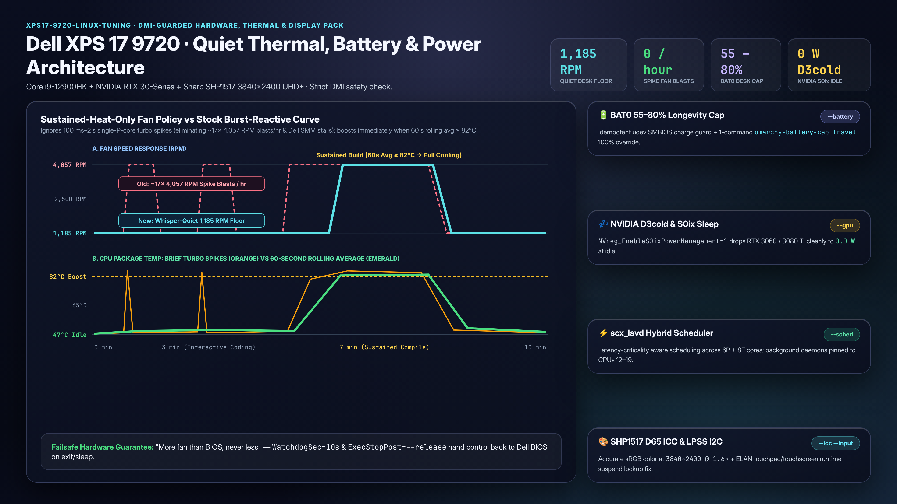

# xps17-9720-linux-tuning

Measured, failsafe **thermal, acoustic, battery, GPU, scheduler, Wi-Fi, I2C input, and display color tuning** for the **Dell XPS 17 9720** (Intel Core i9-12900HK + NVIDIA RTX 3060 + Sharp `SHP1517` 3840×2400 UHD+ panel) running Linux / [Omarchy](https://omarchy.org).

> [!CAUTION]
> **Hardware-Specific Configuration.** These udev rules, PCI addresses (`0000:00:15.0`/`0000:00:15.1`), Dell SMM opcodes (`0x30a3`/`0x31a3`), and the `SHP1517` D65 ICC profile are engineered specifically for the **Dell XPS 17 9720**. `install.sh` enforces a **mandatory DMI guard** checking `/sys/class/dmi/id/product_name` and refuses to write configs on other hardware unless `--force` is explicitly passed.

<p align="center">
  <a href="assets/thermal-fan-profile.png"></a>
</p>

## Modules Included

| Flag | Files | Purpose |
|---|---|---|
| **`--fans`** | `governor/xps17-fan-governor`<br>`systemd/xps17-fan-governor.service`<br>`systemd/10-quiet-sustained.conf`<br>`modprobe/dell-smm-hwmon-xps17.conf`<br>`kernel/xps17-9720-fan-control.patch` | Failsafe **"more fan than BIOS, never less"** governor pinned to E-cores `12–19` (`WatchdogSec=10s`, `ExecStopPost=--release`). With `10-quiet-sustained.conf`, ignores brief 100 ms–2 s single-P-core spikes (eliminating ~17 nuisance `4,057 RPM` blasts/hr & SMM latency stalls) to keep a quiet `1,185 RPM @ 47°C` desk floor while boosting immediately when `60 s` rolling average reaches `≥ 82°C`. |
| **`--battery`** | `bin/omarchy-battery-cap`<br>`udev/82-xps17-battery-cap.rules` | Enforces Dell `Custom` `55–80%` `BAT0` charge thresholds across reboots with idempotent udev guards (avoiding redundant SMBIOS SMI writes). One-command `omarchy-battery-cap travel` temporarily switches to `100%` Standard mode. |
| **`--input`** | `udev/81-xps17-touchscreen-power.rules`<br>`udev/99-i2c-touchpad-controller-awake.rules` | Keeps Intel LPSS I2C controllers `0000:00:15.0` (ELAN2097 touchscreen) and `0000:00:15.1` (ELAN `04F3:311C` touchpad) out of runtime suspend to eliminate silent mid-session touchpad/touchscreen lockups. |
| **`--gpu`** | `modprobe/nvidia-power.conf` | Sets `NVreg_EnableS0ixPowerManagement=1` so the discrete RTX 3060 drops cleanly to `0 W` `D3cold` at idle and preserves VRAM across `s2idle` sleep. |
| **`--wifi`** | `modprobe/iwlwifi.conf` | Sets `options iwlmvm power_scheme=1` on Intel AX211 for minimal latency and zero power-save ping jitter. |
| **`--sched`** | `scx/config.toml` | Configures `scx_loader` to run `scx_lavd` (`Auto`) for latency-criticality-aware scheduling across the i9-12900HK's 6P + 8E hybrid cores. |
| **`--icc`** | `icc/SHP1517-d65.icc`<br>`hypr/monitors.xps17.lua.example` | EDID-verified D65 wide-gamut ICC clamp (no VCGT) for the UHD+ Sharp `0x1517` panel so sRGB desktop UI stays accurate at `3840×2400 @ 1.6×` fractional scaling without oversaturation. |

## Quick Install

### Modular Portable Installer (DMI-Guarded)

```bash
git clone https://github.com/akshaybapat6365/xps17-9720-linux-tuning.git
cd xps17-9720-linux-tuning

# Preview planned changes without modifying the system
./install.sh --all --dry-run

# Install selected modules (or --all)
./install.sh --fans --battery --input --gpu --wifi --sched --icc
```

If you install `--fans`, build and load the patched `dell_smm_hwmon` driver using `kernel/xps17-9720-fan-control.patch` (adds DMI-gated `xps17_fan_ctrl=1` + sleep/resume/unbind BIOS hand-back safety hooks), then enable the service:

```bash
sudo systemctl enable --now xps17-fan-governor.service
```

### Arch Linux (`PKGBUILD`)

```bash
makepkg -si
# Package stages configs safely under /usr/share/xps17-9720-linux-tuning/ without auto-mutating /etc.
# Apply chosen modules via the DMI-guarded helper:
xps17-9720-tuning-apply --all --dry-run
xps17-9720-tuning-apply --all
```

## Battery Mode Switcher

```bash
omarchy-battery-cap status    # Show BAT0 health %, charge level, voltage, and thresholds
omarchy-battery-cap desk      # Enforce Custom 55-80% charge cap (persists across reboots)
omarchy-battery-cap travel    # Allow 100% Standard charge until reboot or 'desk'
```

## Companion Studio Audio Stack (`xps17-studio-audio`)

For the quad-speaker subsystem (`2×2W` woofers + `2×2W` tweeters on dual SoundWire `ALC1316` smart amplifiers, `DMI product_sku = 0AFF`), install the companion **[`xps17-studio-audio`](https://github.com/akshaybapat6365/xps17-studio-audio)** engineering stack (custom `snd-soc-rt1316-sdw` v7.2.15.2 DKMS hardware crossover `0xC202=0xC0`, SOF IPC4 DRC fence, 4096-tap minimum-phase FIR kernels, and 7-stage AVX2/FMA + Rust LADSPA DSP engine).

## Hyprland Display Setup (`SHP1517-d65.icc`)

See [`hypr/monitors.xps17.lua.example`](hypr/monitors.xps17.lua.example) for wiring `SHP1517-d65.icc` at `3840x2400@59.994` with `scale = 1.6` and `cm = "auto"`.

## Uninstall

```bash
./uninstall.sh --all          # Or pass specific flags like --fans --battery
```

## License

[MIT](LICENSE) © 2026 Akshay Bapat
